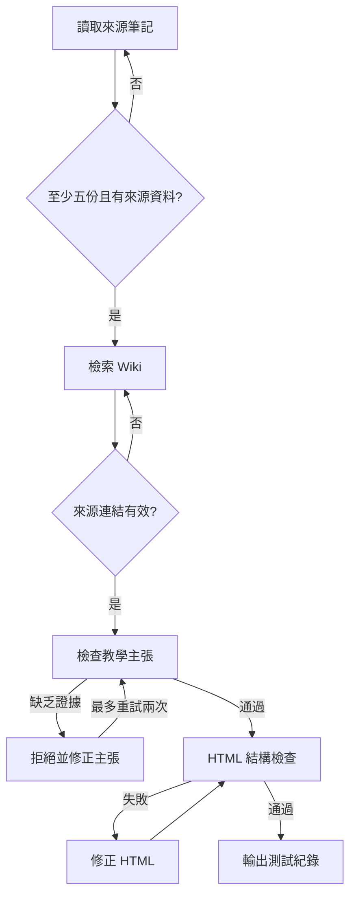

# LLM Wiki × HTML 教學簡報｜繳交內容草稿

## 1. Wiki 主題與簡介
**The Choice Lab｜消費設計觀察室**。以「選擇架構（Choice Architecture）」為唯一核心知識，利用餐廳菜單解密和日本販賣機設計兩個案例，教觀眾辨識選項呈現、視覺提示與商品位置如何構成決策環境，並理解效果的限制。

## 2. Wiki 連結與結果
**Wiki 連結：［部署後填入 GitHub 的 wiki/index.md 網址］**
本地 Wiki 有五篇知識頁 W01–W05，來源資料筆記六份 S01–S06。已核對並匯入六份公開摘要／公開網頁內容的中文轉述筆記，並附來源 URL、研究要點與限制；**不是六篇全文 ingest**。檢索範例見 `logs/retrieval-output.txt`。

## 3. HTML 教學簡報連結
**簡報網址：［部署 GitHub Pages 後填入］**
12 頁，含點餐、菜單解密、販賣機配置與理解測驗，完整檔案 `index.html`。

## 4. Loop / Graph 設計

目前程式實際實作來源、檢索、連結、主張拒絕／規則修正重試、HTML 靜態檢查。HTML 修正箭頭是設計流程，並未實作自動 HTML 修正。

## 5. 真實執行與檢查紀錄
- 正常流程：`logs/graph-normal.json`，結果 PASS，重試 0 次。
- 故意注入「銷量一定增加100%」：`logs/graph-rejection.json`，證據檢查拒絕一次，規則式修正為「商品位置與資訊呈現可能影響注意力，但銷量效果仍需驗證」，再次檢查通過，結果 PASS，重試 1 次。
- Wiki 檢索：`logs/retrieval-output.txt`。
- HTML 檢查：12 頁、五種 Wiki 標記、菜單／販賣機／測驗互動函式存在；這是靜態檢查，不等於瀏覽器操作測試。

## 6. 反思
本次最容易出問題的是「主張查證」節點：把商品放在顯眼位置，不等於一定能提高銷量。透過故意注入錯誤主張，系統在檢查節點拒絕並執行一次修正重試。因而將來源限制與絕對化主張檢查安排在 HTML 檢查之前，避免無根據的內容進入教學簡報。未來應增加真正的 LLM 生成／修正節點、全文來源擷取、來源逐句對照，以及瀏覽器自動化互動測試；目前不可宣稱這些功能已實作。
